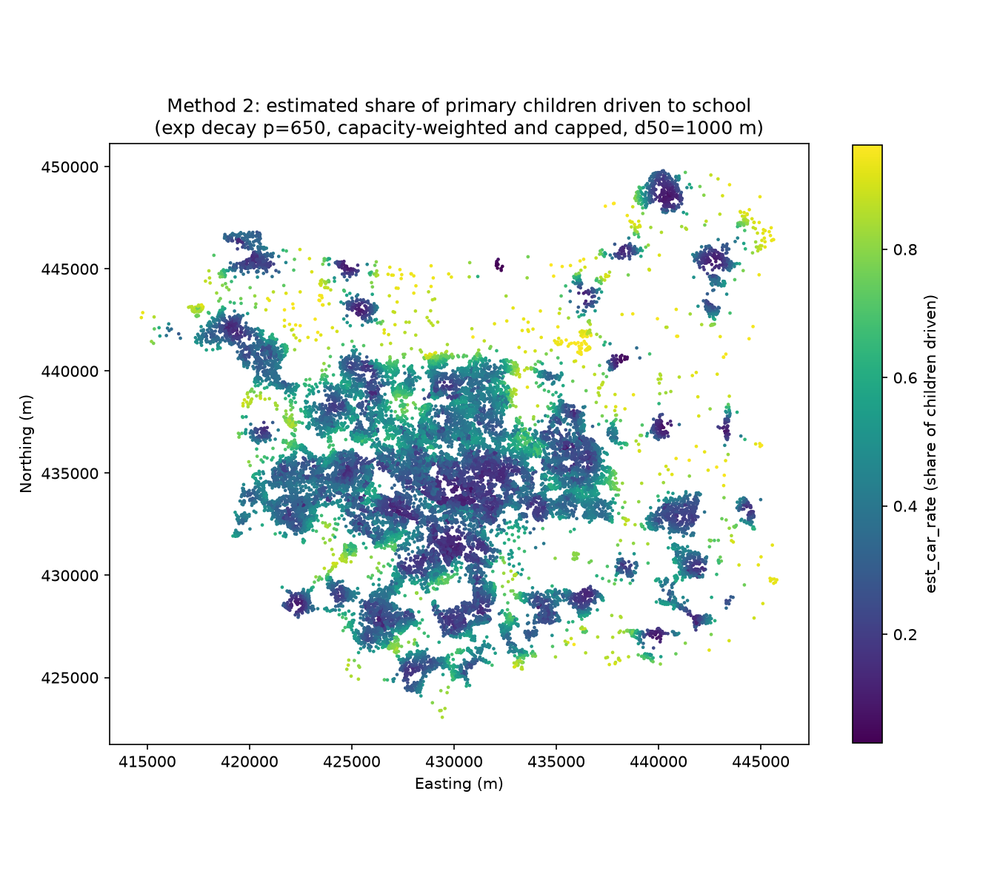
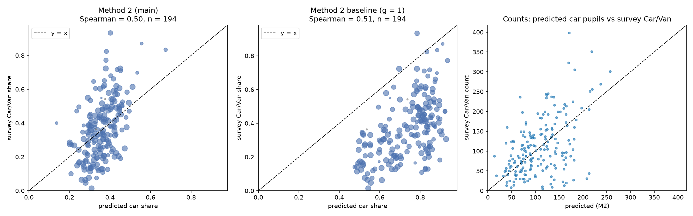
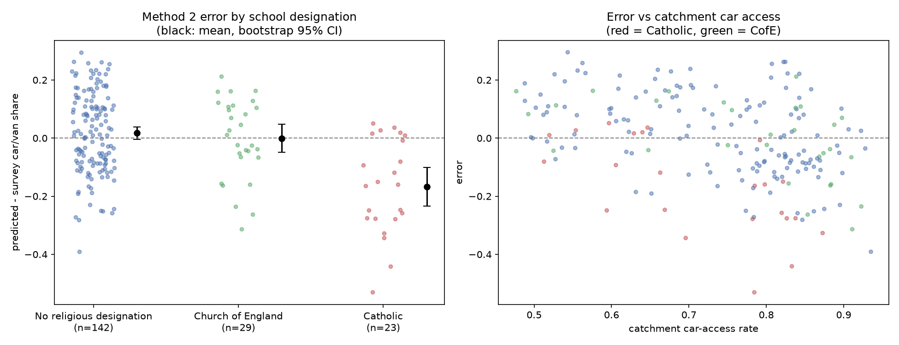
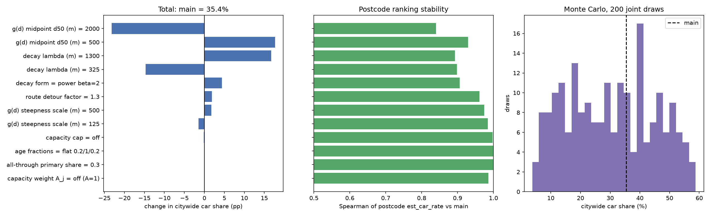

# Postcode-level estimation of school-run car use in Leeds

**Client:** Hastings Direct  **Team:** Team 9  **Status:** DRAFT generated by `src/stage7_report.py`

> **Notes for the team (delete before submission)**
> 1. The main brief was not available when this draft was written. Check the following against it: the definitions of Method 1 and Method 2, the definition of car access, the target variable, the word limit and any required sections.
> 2. **Target variable.** Our earlier draft used P(Car | Access) = P(Car) / P(Access). This report estimates the *number* of primary-age children driven to school from each postcode, and gives the car rate per child as a second output. The two are linked: P(Car | Access) = est_car_rate / car_rate. The team needs to agree which one is the headline.
> 3. Every number below is filled in by code. To change a number, change the analysis and re-run the script. Do not edit the number by hand. The source of every number is listed in `outputs/report_numbers.csv`.

## Executive summary

- **What we estimated.** For each of the 20,799 postcodes in the study area, we estimated how many primary-age children live there and how many of them are driven to school.
- **How.** We combined Census 2021 age and car-access data with a probabilistic model of which school each child attends. The model is a production-constrained gravity model with school capacity limits. A distance-dependent probability then decides whether a family with a car actually drives.
- **Headline.** About 24,319 of 68,785 children (35.4%) are estimated to be driven. If every child in a car-owning household were driven, the figure would be 71.9%; this is the upper bound.
- **The level is not identified by the data.** It depends mainly on one assumed parameter: the distance at which half of the families with a car choose to drive (d50). When the uncertain parameters vary jointly, the citywide share ranges from 7.9% to 54.1% (90% band).
- **The ranking of postcodes is much more robust** than the level. Across those draws, the median Spearman correlation with the main model is 0.93.
- **Validation against the 2025 Travel to School survey** (used only for validation):
  - the model ranks schools moderately well (Spearman 0.50, 194 schools);
  - the spread between schools is compressed: the standard deviation of predictions is 0.072, against 0.177 observed;
  - the model does not reproduce the 2024 admission cut-off distances (Spearman -0.06).
- **Fairness.** At Catholic schools the mean error (predicted minus observed, 95% CI) is -0.167 [-0.234, -0.101], so car use there is under-estimated. These schools admit by faith rather than by distance. This creates a proxy-discrimination risk even though religion is not an input. The model also over-estimates car use in low-car-access areas.
- **Recommendation.** Use the estimates as a *relative* risk score (rank or decile), together with the uncertainty bands we provide. Do not use them as absolute counts until d50 is anchored on an external source agreed with Hastings Direct and the faith-school bias is corrected.

## 1. Introduction and objective

Hastings Direct wants to know where the school run puts more cars on the road, at the level of individual postcodes. Our objective is:

> For every postcode *i*, estimate est_car_kids_i: the expected number of primary-age children who live in *i* and are driven to school by car or van.

There are two methods:

- **Method 1** assigns every child to the nearest school.
- **Method 2** gives each child a probability of attending each school.

We then validate the results against two independent sources, check fairness and test sensitivity. The 2025 survey and the 2024 cut-off distances are **validation data only**. They were never used as model inputs or to choose parameters.

## 2. Data

| Source | Role | Key facts (computed) |
|---|---|---|
| Postcode locations (OS grid X/Y, OA code) | Input | 20,799 postcodes in 2,606 output areas (OAs); on average 8.0 postcodes per OA, at most 139 |
| School locations (DfE number, capacity, roll, X/Y) | Input | 225 schools; 4 all-through schools (DfE 4xxx); 3 missing rolls |
| Census 2021 age bands by OA | Input | 68,785 primary-age children |
| Census 2021 car access by OA | Input | Household-weighted share with 1 or more cars: 0.713 |
| Census 2021 households by OA | Input | Used to check the car table |
| 2025 Travel to School survey | Validation only | 196 of 225 schools linked by name |
| 2024 admission cut-off distances (PDF) | Validation only | 226 rows: 147 "all admitted", 76 numeric, 3 non-standard |
| 2024-25 Summary report (PDF) | Sanity check of the aggregate only | See Section 5.1 |

**Children per postcode**

- Primary age means Reception to Year 6 on Census day (21 March 2021). We take 1/12 of the 0–4 band, all of the 5–9 band and 19/60 of the 10–14 band, which makes exactly seven school cohorts. A flat 0.2/1/0.2 split would give 68,625 children instead of 68,785, so the choice barely matters.
- Each OA's children are split **equally** between its postcodes, because no population figures below OA level are provided. Giving every postcode the OA's full child count would inflate the total 8.0 times.
- The total is 0.934 of the combined primary roll of the listed schools (73,614). The gap is expected: we use 2021 ages for 2024/25, and some pupils on the rolls live outside the study area.

**Car access.** A household has car access if it has one or more cars or vans. The rate is 1 − (no car) / (table total). The numerator and denominator come from the same table, so the rate always lies between 0 and 1.

**Distances.** We use straight-line distance in metres between OS grid coordinates. The distance matrix is 20,799 × 225.

- The median distance to the nearest school is 425 m and the 90th percentile is 904 m.
- The maximum is 3,612 m, and 13 postcodes are more than 3 km from any listed school.

## 3. Methods

### 3.1 Method 1 – nearest school

Every child attends the nearest listed school. This is simple, but the resulting school intakes barely relate to real rolls:

- the correlation between assigned children and NumberOfPupils is 0.167;
- 25 schools receive more than 1.5 times their capacity, and 36 receive less than half.

Without a distance-based car model, the only available rule is that every child with car access is driven. This gives an upper bound of 49,467 children (71.9%), the number living in households with a car.

### 3.2 Method 2 – probabilistic attendance

For postcode *i* and school *j*:

- **Attendance:** P(j | i) = A_j · B_j · exp(−d_ij / λ) / Σ_k A_k · B_k · exp(−d_ik / λ)
- **Car use:** P(car | i, j) = car_rate_i · g(d_ij), where g(d) = 1 / (1 + exp(−(d − d50) / s))
- **Estimate:** est_car_kids_i = est_kids_i · Σ_j P(j | i) · P(car | i, j)

The terms mean:

- **A_j** is the school's primary-phase capacity. For all-through schools this is 7/14 of the total, since 7 of the 14 year groups are primary.
- **B_j ≤ 1** is a balancing factor, found iteratively, so that no school receives more children than max(capacity, roll). 59 schools are capped; the strongest cap is at Bardsey Primary Academy (B = 0.12).
- **g(d)** is the share of car-owning families who drive. It rises with distance because short trips are usually walked. We fixed d50 = 1,000 m (about a 15–20 minute walk for a primary child) and s = 250 m **before** looking at any validation data.

**Choosing λ.** We used input data only: λ is chosen as the value under which population and distance alone (A = 1, no cap) best reproduce the real rolls of 218 schools.

- We compared exponential and power decay. The best power exponent was β = 2.00. The exponential form won on mean out-of-sample RMSE in a 2-fold school split (seed 42): 115.4 against 115.7. This is practically a tie; we prefer the exponential form because its parameter has a clear meaning.
- The selected value is λ = 650 m. The two folds chose 1,000 m and 550 m, so λ is only weakly identified.
- Calibrating with A = capacity was rejected. Capacity is close to the roll already, so the fit is best when distance plays no role at all, and the criterion no longer identifies the decay.

**Each refinement improves the fit to real rolls** (rolls are an input, not validation data):

| Version | Corr. with roll | RMSE vs roll | Schools over capacity | Median trip (m) | Car share |
|---|---|---|---|---|---|
| M1 nearest school | 0.391 | 159.5 | 89 | 382 | 10.2% |
| M2a exp decay only (p=650) | 0.548 | 113.3 | 85 | 913 | 35.2% |
| M2b exp + capacity weight | 0.868 | 72.1 | 44 | 914 | 35.2% |
| M2c exp + capacity weight + cap (MAIN) | 0.884 | 66.6 | 0 | 917 | 35.4% |

The car share column applies the same g(d) in every row. For Method 1 it is low because each child is sent to the nearest school, so trips are short. Method 1's upper bound without g(d) is given in Section 3.1.

## 4. Results

- **Total.** The main model estimates **24,319 car-driven children, 35.4% of all primary-age children**. The median home-to-school trip is 917 m.
- **Postcodes.** The estimated car rate per child varies from 18.1% (10th percentile) to 60.1% (90th percentile), with a median of 33.8%. It is highest in rural and peri-urban postcodes far from schools: the Spearman correlation with the distance to the nearest school is 0.59.
- **Upper bound.** The baseline with g = 1 (every family with a car drives) gives 71.9%.
- **The total depends mainly on d50:** 53.0% and 12.2% at the low and high ends of the tested range (Section 7).

## 5. Validation

### 5.1 Aggregate sanity check

- **Survey.** On the 194 compared schools, the pooled survey car/van share is 0.354 and our model predicts 0.357.
- **Summary report.** The 2024-25 Summary report gives 35.4% for primary car/van travel in Leeds (4 mentions of this figure). However, one passage calls 35.4% the *national* average and says Leeds is lower. **We should confirm with the client which figure applies to Leeds.**
- **The agreement is a coincidence of the d50 assumption, not evidence that the level is right.** d50 was fixed in advance, and other plausible values give totals between 12.2% and 53.0%.

### 5.2 School matching

The survey has no DfE numbers, so schools were matched by name in four steps:

- 147 exact matches;
- 17 after normalisation;
- 24 fuzzy matches (score ≥ 95, all checked by hand);
- 8 manual links, each with a recorded reason (`data/manual/manual_matches.csv`).

In total 196 of 225 schools are linked. The cut-off PDF is keyed by DfE number: 222 schools match directly, and 3 changed number after conversion to academies.

### 5.3 Survey: car/van share by school

Compared schools: 194, all primary. Survey coverage is high: the median of respondents divided by the roll is 1.01.

| Model | Spearman | MAE | Bias | SD predicted / observed |
|---|---|---|---|---|
| Method 2 (main) | 0.50 | 0.124 | -0.007 | 0.072 / 0.177 |
| Method 2 baseline (g = 1) | 0.51 | 0.373 | +0.371 | 0.123 / 0.177 |
| Method 1 (nearest school) | 0.44 | 0.261 | -0.257 | 0.089 / 0.177 |
| Constant = observed mean (reference) | – | 0.143 | +0.000 | 0.000 / 0.177 |

- **Ranking.** The model ranks schools moderately (Spearman 0.50, Pearson 0.52). Its absolute error is only a little better than predicting the observed mean for every school (MAE 0.124 against 0.143).
- **Compression.** The predictions are too similar across schools: the slope of observed on predicted is 1.27.
- **Where the ranking comes from.** The baseline ranks schools just as well (Spearman 0.51) but overshoots the level by 0.371. So most of the ranking signal comes from the car access of each school's catchment, and g(d) mainly sets the level.
- **Method 1 is worse** (Spearman 0.44, bias -0.257).
- **Counts.** When the predicted share is multiplied by the number of respondents, the correlation with the survey car/van counts is 0.71.
- **Largest errors:**
  - under-prediction at St Francis Catholic Primary School, Morley: observed 93.3%, predicted 40.2%;
  - over-prediction at Castleton Primary School: observed 1.4%, predicted 30.9%.
- **A setting we did not adopt.** A shorter λ and d50 would rank schools better (Spearman up to 0.61 at λ = 325 m, d50 = 500 m). Adopting it would mean tuning on validation data, so this is reported only.

### 5.4 Admission cut-off distances

We compared the model's implied catchment of each school (the distance within which 80% of its predicted pupils live) with the 2024 cut-off distance, for 77 schools.

- **There is no relationship** (Spearman -0.06). The median cut-off is 1,088 m, against a median implied catchment of 1,763 m. Across all 225 schools, the median implied catchment is 1,730 m.
- **Oversubscription is not detected:** using model fullness to separate oversubscribed schools from the rest gives AUC = 0.475.

The reason is that a single λ gives every school a similar catchment, whereas real cut-offs reflect demand and popularity, which the inputs do not contain.

## 6. Fairness

Religion and other protected characteristics are **not** model inputs. Here they are used only to audit the estimates. The religion-by-OA table was not provided, so the OA-level religion check was **not run**. Its method is written and tested (`outputs/fairness_method.md`) and runs as soon as the file is added.

**Error by school designation.** The ReligiousEthos field in the school list marks 0 of the 27 Catholic schools as Catholic, so designation was taken from the school name. Errors are predicted minus observed, with bootstrap 95% CIs:

| Designation | Schools | Observed | Predicted | Mean error [95% CI] |
|---|---|---|---|---|
| Catholic | 23 | 52.2% | 35.5% | -0.167 [-0.234, -0.101] |
| Church of England | 29 | 37.8% | 37.7% | -0.001 [-0.049, +0.048] |
| No religious designation | 142 | 33.8% | 35.6% | +0.018 [-0.005, +0.039] |

- **The groups differ** (Kruskal–Wallis p < 0.0001).
- **The Catholic gap remains after controlling for catchment car access:** -0.199 [-0.258, -0.143].
- **Why it happens.** Catholic schools admit by faith first, so their pupils travel further and are driven more often. A distance-only model cannot see this.
- **Why it matters.** Because the error is likely to be correlated with religion, pricing on these estimates could disadvantage or advantage families by religion **by proxy**, even though religion is never used.

**Socio-economic pattern.**

- Errors fall as catchment car access rises (Spearman -0.40). The mean error is +0.082 in the quintile of schools with the lowest car access (over-estimate) and -0.093 in the highest (under-estimate).
- In pricing terms, poorer areas would carry too much school-run exposure.
- Spread to postcodes, the school-level errors exceed 10 percentage points for 24.0% of children. This is a diagnostic only; no correction was applied.

## 7. Sensitivity and limitations

**One change at a time.** Each row changes one assumption from the main model; the Spearman and overlap columns compare postcodes with the main model:

| Change | Car share | Spearman vs main (postcodes) | Top-10% overlap |
|---|---|---|---|
| decay lambda (m) = 325 | 20.7% | 0.90 | 88% |
| decay lambda (m) = 1300 | 52.1% | 0.89 | 85% |
| decay form = power beta=2 | 39.8% | 0.91 | 90% |
| g(d) midpoint d50 (m) = 500 | 53.0% | 0.93 | 88% |
| g(d) midpoint d50 (m) = 2000 | 12.2% | 0.84 | 76% |
| g(d) steepness scale (m) = 125 | 33.9% | 0.98 | 96% |
| g(d) steepness scale (m) = 500 | 37.1% | 0.97 | 95% |
| route detour factor = 1.3 | 37.2% | 0.96 | 91% |
| capacity weight A_j = off (A=1) | 35.3% | 0.99 | 96% |
| capacity cap = off | 35.2% | 1.00 | 99% |
| all-through primary share = 0.3 | 35.3% | 1.00 | 100% |
| age fractions = flat 0.2/1/0.2 | 35.3% | 1.00 | 100% |

**Joint uncertainty.** We ran 200 Monte Carlo draws of λ, d50 and the g(d) scale (seed 42; the ranges are judgement calls, see the assumptions log).

- The citywide share has a 90% band of 7.9% to 54.1%, with a median of 29.6%.
- d50 drives the level most (Spearman with the share -0.78), followed by λ (0.62).
- The postcode ranking stays close to the main model: median Spearman 0.93, minimum 0.74.
- 64.2% of the main model's top-10% postcodes stay in the top 10% in at least 90% of draws.
- Per-postcode bands are in `outputs/estimates_postcode_uncertainty.csv`.

This stability is the model agreeing with itself, not accuracy: against the survey, the school ranking is only Spearman 0.50.

**Main limitations** (the full table is in `outputs/limitations.md`):

1. d50 is assumed, not estimated.
2. Attendance depends on distance only, with one λ for all schools.
3. Faith and other non-distance admissions are ignored.
4. car_rate covers all households, not households with children.
5. Children are split equally across the postcodes of an OA.
6. Census 2021 ages are used for 2024/25.
7. Only the 225 listed schools are included. There are 2,637 children in WF and 787 in BD postcodes, against 65,361 in LS, and some of them probably attend schools outside Leeds.
8. Distances are straight-line.

## 8. Conclusions and recommendations

1. Method 2 reproduces real school rolls far better than nearest-school assignment. Its postcode *ranking* of school-run car use is robust, but its *level* is not identified by the data provided.
2. Use `est_car_rate` as a relative score (rank or decile), together with the provided uncertainty bands.
3. Before the estimates are used for pricing:
   - anchor d50 on an external source agreed with the client. If the survey is used for this, tune on one half of the schools and report the result on the other half;
   - add an admission-type feature for faith and other non-distance schools, tuned on held-out schools;
   - use car access of households *with children*.
4. Monitor errors by school designation and by car-access quintile at every refresh. Run the religion-by-OA audit when the census table is available.

## Appendix A – Reproducibility

- Python 3.14; all random seeds = 42.
- Run the stages in order: `src/stage1_data_prep.py` … `src/stage6_sensitivity.py`, then `src/stage7_report.py`.
- Tests: `.venv/bin/python -m pytest tests -q`.
- Assumptions with their reasons and effects: `outputs/assumptions_log.md`.
- The source of every number in this report: `outputs/report_numbers.csv`.
